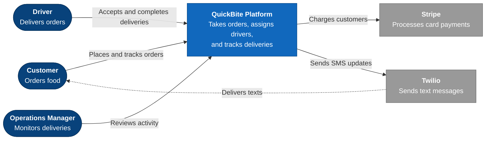
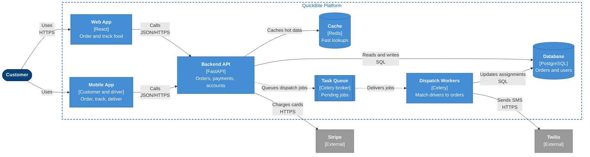
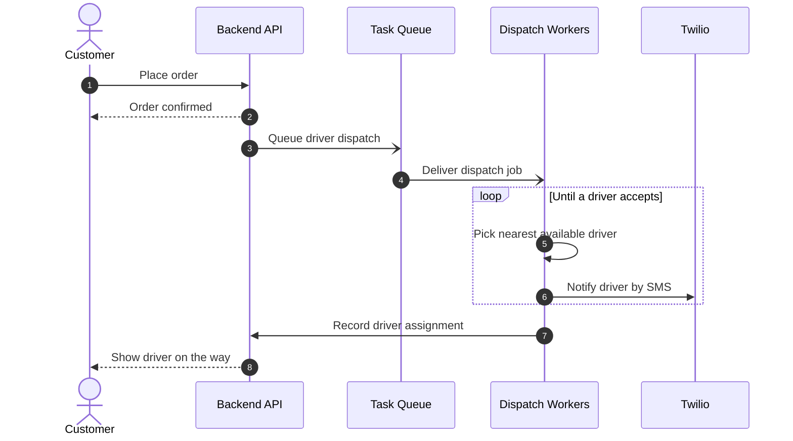

<!-- Worked example: the expected shape of a delivered answer (verified to lint and render).
     Request was: food-delivery app, React web + mobile, FastAPI, Postgres, Redis, Celery, Stripe, Twilio;
     audience includes ops managers. Imitate the structure and label style, not the content. -->

### QuickBite: System Context (C4 Level 1)

**Purpose:** Shows who uses the QuickBite platform and which outside services it relies on.

**How to read it:** Customers order through QuickBite, drivers receive and complete deliveries, and operations managers watch it all. QuickBite hands payments to Stripe and text messages to Twilio rather than building those itself.

### QuickBite: Containers (C4 Level 2)

**Purpose:** Shows the deployable parts of QuickBite and how they communicate.

### Assignment flow: UML Sequence

