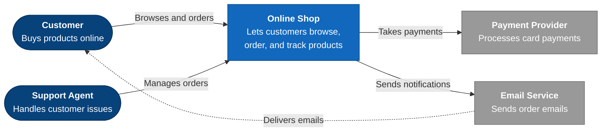
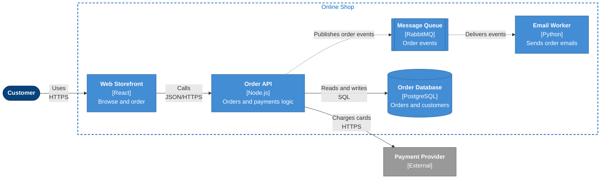
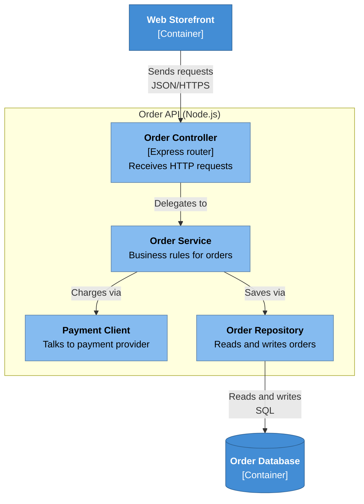
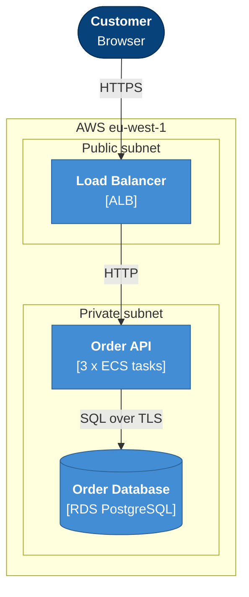

# C4 Diagrams in Mermaid (flowchart-based)

Mermaid has native `C4Context` / `C4Container` blocks, but they are experimental, have weak layout control, and are frequently written incorrectly by LLMs. This skill uses plain `flowchart` with consistent styling instead. It renders identically on GitHub, GitLab, Notion, Confluence plugins, and MkDocs.

## Contents
1. Shared palette (paste at the bottom of every C4 diagram)
2. Node shape conventions
3. Level 1: System Context
4. Level 2: Container
5. Level 3: Component
6. Deployment view
7. Label formula

---

## 1. Shared palette

Paste only the classes you use, at the **bottom** of the diagram:

```
    classDef person fill:#08427b,stroke:#052e56,color:#ffffff
    classDef system fill:#1168bd,stroke:#0b4884,color:#ffffff
    classDef container fill:#438dd5,stroke:#2e6295,color:#ffffff
    classDef component fill:#85bbf0,stroke:#5d82a8,color:#000000
    classDef database fill:#438dd5,stroke:#2e6295,color:#ffffff
    classDef external fill:#999999,stroke:#6b6b6b,color:#ffffff
```

Style every system/deployment boundary (`subgraph`) with a dashed outline and no fill, using the subgraph's id:

```
    style shop fill:none,stroke:#1168bd,stroke-width:2px,stroke-dasharray:6 4,color:#1168bd
```

Meaning (put in the Legend when the audience is non-technical):
- Dark blue = person/user
- Blue = the system being documented
- Lighter blue = parts inside it (containers, components)
- Grey = external systems we do not own

## 2. Node shape conventions

| Element | Shape syntax | Class |
|---|---|---|
| Person | `id(["..."])` stadium | `person` |
| Our system (Level 1) | `id["..."]` rectangle | `system` |
| Container / component | `id["..."]` rectangle | `container` / `component` |
| Database / datastore | `id[("...")]` cylinder | `database` |
| Queue / event bus | `id[["..."]]` subroutine | `container` |
| External system | `id["..."]` rectangle | `external` |

## 3. Level 1: System Context

Question answered: *What is this system, who uses it, and what does it depend on?* Audience: everyone. No internal parts, no technology.



Rules: exactly one `system` node (the thing being documented). Everything else is a person or an external system. ≤ 8 nodes total.

## 4. Level 2: Container

Question answered: *What is the system made of, and how do the parts talk?* Audience: engineers plus curious stakeholders. Show the system boundary as a subgraph; people and external systems sit outside it.



Rules: every container shows `[Technology]`. Dotted arrows are asynchronous. Subgraph syntax is `subgraph id ["Title"]` (id first, quoted title in brackets).

## 5. Level 3: Component

Question answered: *What are the major building blocks inside one container?* Audience: engineers. Pick ONE container, show its components, and show only the neighbours it talks to as outside nodes.



## 6. Deployment view

Question answered: *Where does each piece run?* Use nested subgraphs for environment, region, cluster, network zone. Max 2 levels of nesting.



## 7. Label formula

```
"<b>Name</b><br/>[Technology]<br/>One-line plain-language responsibility"
```

- Name: 1 to 3 words, business language.
- `[Technology]`: omit at Level 1 and in exec-facing diagrams.
- Responsibility: ≤ 8 words, starts with a verb or noun phrase, no jargon.
- Edge label: `"Verb phrase<br/>Protocol"`, for example `"Places orders<br/>HTTPS"`.

If a renderer shows raw `<b>` tags (rare), drop the bold tags and keep `<br/>`.
