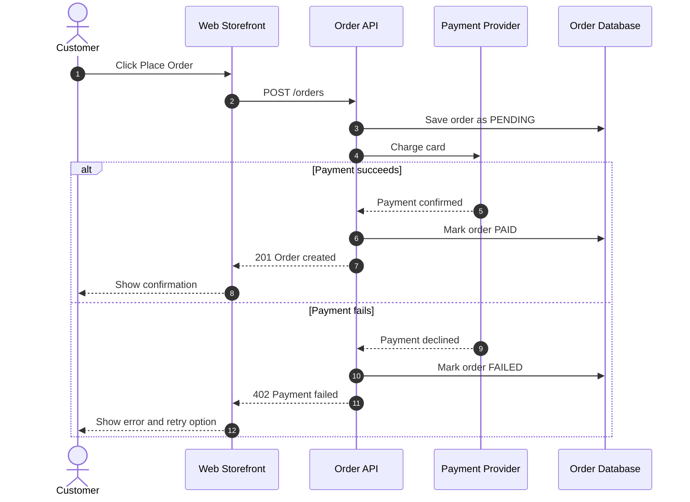
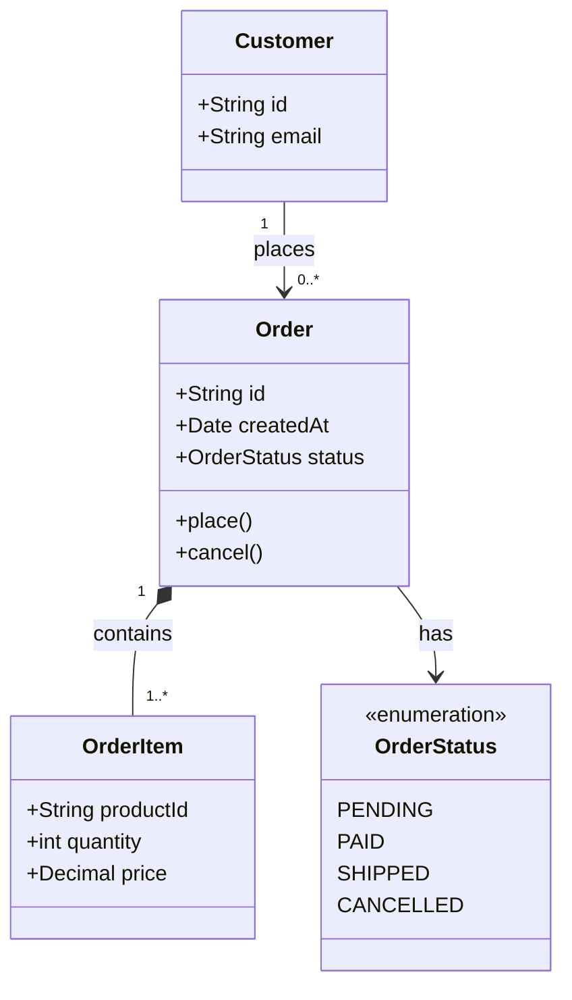
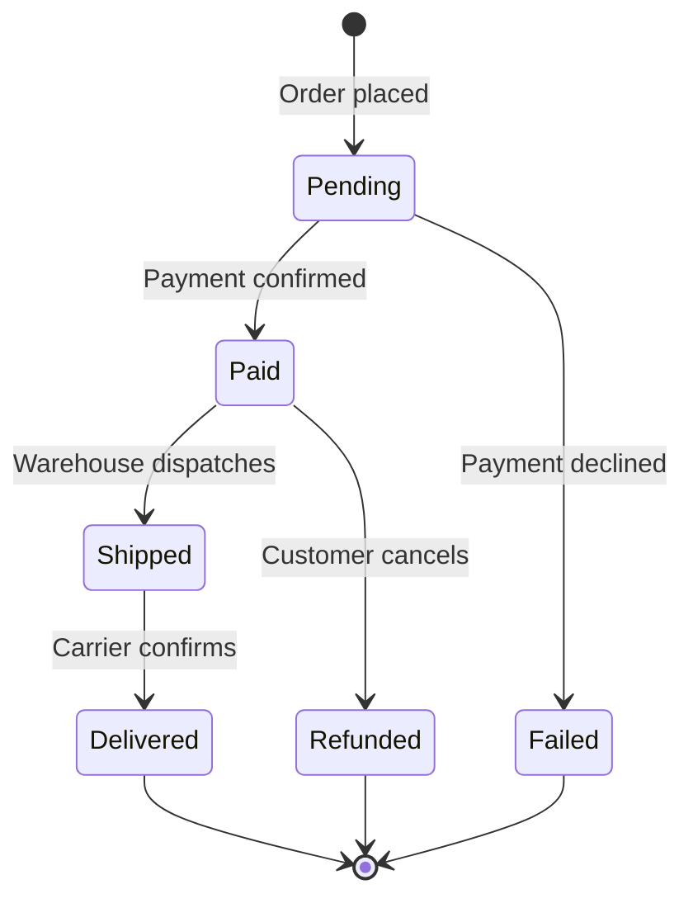
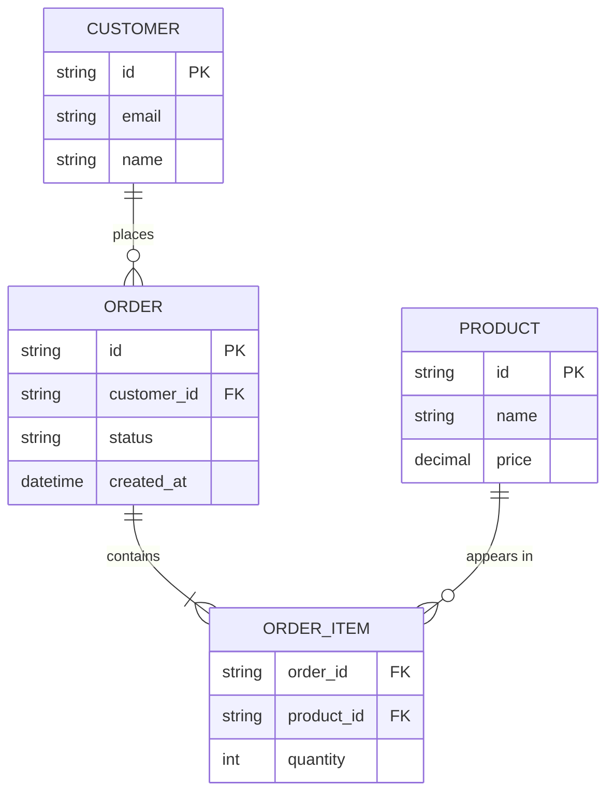

# UML Diagrams in Mermaid

Use UML to show *behaviour* and *detail* that C4 boxes-and-arrows cannot: ordering over time, data models, lifecycles.

## Contents
1. Sequence diagram (runtime flows)
2. Class diagram (structure, C4 Level 4)
3. State diagram (lifecycles)
4. ER diagram (database schema)
5. Choosing between them

---

## 1. Sequence diagram

Question answered: *What happens, in order, when X occurs?* Best for API calls, auth flows, async pipelines, failure handling.

Rules:
- Declare every participant first with `participant id as Display Name`. Use `actor` for humans.
- Arrows: `->>` request/sync call, `-->>` response/return, `-)` async fire-and-forget.
- Message text has no quotes; avoid `;` and `#` inside messages (they break parsing). Write "number" not "#".
- Use `alt/else/end`, `opt/end`, `loop/end`, `par/and/end` for control flow. Each needs its `end`.
- `Note over a,b: text` for clarifications. Keep notes short.
- ≤ 6 participants and ≤ 15 messages per diagram. Split long flows into phases.
- Participant names should match the node names in the C4 container diagram.

## 2. Class diagram

Question answered: *What are the main types and how do they relate?* Use for domain models or one component's structure, never a whole system.

Relationship cheat sheet:

| Syntax | Meaning |
|---|---|
| `A --> B` | A uses / depends on B |
| `A --\|> B` | A inherits from B |
| `A ..\|> B` | A implements interface B |
| `A *-- B` | A is composed of B (B cannot exist without A) |
| `A o-- B` | A aggregates B (B can exist alone) |
| `A .. B` or `A ..> B` | weak link / dependency |

Rules: no generics with angle brackets in member names (use `List~String~` tilde syntax); keep ≤ 8 classes; show only the 3 to 5 most important members per class.

## 3. State diagram

Question answered: *What states can this thing be in, and what moves it between them?*

Rules: use `stateDiagram-v2` (not the old `stateDiagram`). State names are single words or `Name` with underscores; for display text with spaces use `state "Awaiting payment" as awaitingPayment`. Transition labels are plain text after the colon.

## 4. ER diagram

Question answered: *What tables/entities exist and how are they related?*

Cardinality: `||` exactly one, `o|` zero or one, `}o` zero or many, `}|` one or many. Entity names UPPER_SNAKE_CASE without spaces. Relationship labels with spaces must be quoted. Attribute types are single words. Keys are marked `PK`, `FK`, or `UK`.

## 5. Choosing between them

| If the reader asks... | Use |
|---|---|
| "What happens when I click X?" | Sequence |
| "What does the data look like?" | ER (storage) or Class (in-code model) |
| "What can happen to an order over its life?" | State |
| "What are the parts of the system?" | C4 container (see `c4-in-mermaid.md`), not UML |
| "Where does it run?" | Deployment flowchart (see `c4-in-mermaid.md`) |

For non-technical readers prefer sequence and state diagrams (they read like stories) over class and ER diagrams.
