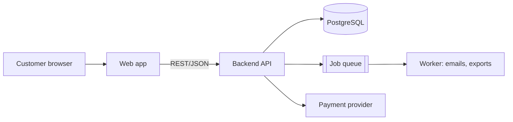

# Product manager documentation

Goal: a PM (or any new stakeholder) can understand what was built, why it works the way it does, what was assumed, what limits the design, how to evolve it, and what was added beyond the brief - without reading code.

Level of detail: more than the client doc, less than the engineering doc. Explain logic in terms of business rules and decisions, and link to engineering docs for exact contracts.

## Contents
1. Template
2. How to fill each section well
3. Architecture and diagrams
4. Decision record format
5. Extensibility section guidance
6. Worked fragments

---

## 1. Template

```markdown
# <Product / Feature> - Implementation Overview
Version | Date | Status | Sources used (code, PRD, tickets)

## 1. Executive summary
Five lines max: what was built, current status, the three things a PM most needs to know
(biggest decision, biggest risk, biggest open question).

## 2. Scope: what was done
### 2.1 Requirement traceability
| Req / ticket | Requirement | Status (Done / Partial / Not done / Changed) | Where implemented | Notes |
### 2.2 Deviations from the original scope
What differs from the brief and why. State who agreed or whether it is awaiting agreement.
### 2.3 Additions beyond scope
Each addition: what, why it was added, effort/cost, risk, and whether it can be switched off.
### 2.4 Not done / deferred
What is missing, why, and what it would take.

## 3. How it works (logic and business rules)
For each major flow: trigger -> steps -> outcome, plus the business rules applied (calculations,
eligibility, ordering, limits, state transitions), in plain language with a diagram if >3 steps.
Include rules about edge cases: duplicates, cancellation, partial failure, timeouts.

## 4. Assumptions
| # | Assumption | Basis (told by / inferred from) | Impact if wrong | Owner to confirm | Status |

## 5. Constraints
Technical, business, regulatory, budget/time, third-party limits, data constraints.
For each: the constraint, its source, and how it shaped the design.

## 6. Architecture
Overview diagram, components and responsibilities, data flow, key technology choices with rationale,
integrations, deployment topology, security model, scalability and performance characteristics (measured or stated limits only).

## 7. Extensibility and flexibility
Extension points, configuration-driven behaviour, feature flags, what is easy to change, what is hard,
and what was deliberately made flexible in anticipation of likely change.

## 8. Key decisions
Short decision records (see format below).

## 9. Known limitations, risks and technical debt
| Item | Impact | Likelihood | Mitigation / recommendation |

## 10. Metrics and observability (if present)
What is tracked that PM can use: events, dashboards, logs, KPIs enabled.

## 11. Recommended next steps
Prioritised suggestions with rationale and rough effort (S/M/L).

## 12. Open questions
Question | Why it matters | Suggested owner | Needed by
```

## 2. How to fill each section well

**Requirement traceability.** Take requirements from the PRD, tickets, or the user's description. For each, find evidence in the code (route, component, job). If there is no evidence, mark it "Not done" or "Unverified" - do not assume it was done. If there is no requirements source, build the table from the features you find and label it "derived from implementation".

**Business logic.** Describe rules the way the business would say them: "A discount code applies to the pre-tax subtotal and cannot combine with another code." Pull rules from validators, services, and tests; tests are an excellent source of intent. Quote exact numbers (thresholds, durations, limits) from the code and say where they are configured.

**Assumptions.** Include things the implementation silently depends on: expected volumes, user behaviour, data quality, availability of a third party, timezone handling, single-currency, one-user-one-organisation, etc. Look for hard-coded values, TODO/FIXME comments, and defaults chosen without a stated reason - each usually hides an assumption. State the consequence if it proves false; that is what makes an assumption actionable.

**Constraints.** Distinguish constraints (imposed from outside) from decisions (chosen). "The payment provider limits batch size to 100" is a constraint; "we chose Postgres" is a decision.

**Additions beyond scope.** Be transparent. Anything built that the brief did not ask for - extra endpoints, admin tools, audit logging, retry logic, caching, config options, abstraction layers - belongs here with a reason. PMs need this to judge cost, maintenance burden, and whether to keep it.

**Limitations and debt.** Honest and specific. "No pagination on the reports endpoint; fine below ~5k rows, degrades after" is useful. "Some performance improvements possible" is not.

## 3. Architecture and diagrams

Use Mermaid so diagrams are text and versionable. Provide at least:
- **System context / component diagram** (`flowchart`): users, frontend(s), backend services, data stores, third parties.
- **Key flow** (`sequenceDiagram`) for the one or two most important or complex flows.
- **State diagram** (`stateDiagram-v2`) for any entity with a lifecycle.
- **ER diagram** (`erDiagram`) if data design matters to the story.

Follow every diagram with a short paragraph or list explaining each component's responsibility and the reason it exists. Diagrams alone are not documentation.

Only diagram what you have verified from code/config. If deployment topology is not visible, say it is unknown rather than drawing a guess.



## 4. Decision record format

```markdown
### D-<n>: <decision title>
Date | Status (accepted / superseded / proposed) | Decided by
**Context:** the problem and forces at play (1-3 sentences).
**Options considered:** A, B, C - one line each.
**Decision:** what was chosen.
**Why:** the reasons tied to constraints or goals.
**Consequences:** what becomes easier, what becomes harder, what to revisit and when.
```

If you did not witness the decision, say so: "Rationale inferred from code structure; confirm with the original author." Do not invent a rationale presented as fact.

## 5. Extensibility section guidance

Make this concrete. For each extension point, describe:

| Aspect | What to write |
|---|---|
| Extension point | The place where new behaviour plugs in (strategy interface, plugin registry, config table, webhook, event bus, feature flag) |
| How to extend | The steps and files involved at a conceptual level, and rough effort |
| What it supports today | Current implementations |
| Limits | What it cannot do without redesign |

Then a "Change cost guide": a short table of likely future changes (new payment provider, new user role, new language, new report, new tenant, higher volume) with Easy / Moderate / Hard and the reason. Base these on the real code structure, and mark the rating as an assessment.

Also list **flexibility built in**: configurable thresholds, environment-driven behaviour, abstraction layers, generic data structures, versioned APIs. And list **deliberate rigidity**: places where it was intentionally kept simple, so no one assumes flexibility that is not there.

## 6. Worked fragments

**Assumption row**
| A-3 | Orders are in a single currency (USD) | Told by PM in kickoff | Pricing and totals would need currency on every amount; reports would break | PM | Open |

**Constraint with design impact**
"The shipping provider only accepts 30 requests per minute (provider contract). Label creation is therefore queued and processed asynchronously, so shipping labels appear within about a minute rather than instantly."

**Addition beyond scope**
"Added an audit log of admin actions (not in the brief). Reason: needed to diagnose a permissions issue during testing. Cost: ~1 day, one extra table. Risk: grows ~N rows per admin action; no retention policy yet. Can be disabled via `AUDIT_LOG_ENABLED`."
